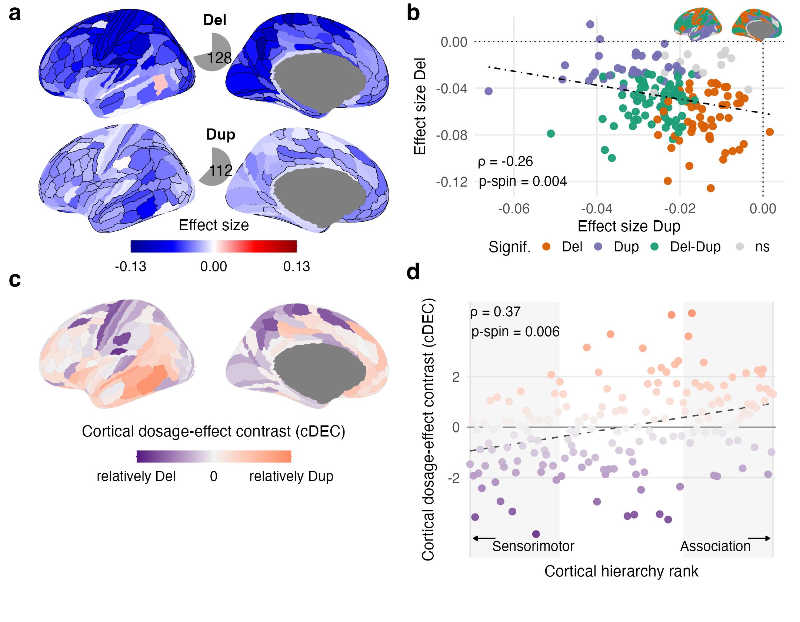

```{r setup, include=FALSE}
knitr::opts_chunk$set(echo = TRUE, warning = FALSE, message = FALSE, fig.path = "Fig2_files/figure-gfm/")
lines_R <- readLines(file.path(dirname(knitr::current_input(dir = TRUE)), "Fig2.R"))   # code chunks are read from Fig2.R
idx_chunk <- grep("^## ---- fig[0-9]_[A-Za-z0-9_]+ ----$", lines_R)
knitr::read_chunk(lines = lines_R, labels = sub("^## ---- (.*) ----$", "\\1", lines_R[idx_chunk]),
                  from = idx_chunk + 1L, to = c(idx_chunk[-1] - 1L, length(lines_R)))
knitr::opts_knit$set(root.dir = normalizePath(file.path(dirname(knitr::current_input(dir = TRUE)), "..", "..")))
```


## Fig. 2: Cortical localization of deletion and duplication effects on cognitive ability
#### -- Figure legend -- ####

a) Cortical maps of deletion and duplication effect sizes across 180 Glasser regions. We performed CC-GSBA for each cortical region, running 180 separate linear models. Effect sizes represent the average effect of genes with high expression in each region on Z-scored cognitive ability, mapped onto the cortex for both deletions and duplications. Regions significant after Bonferroni correction across 360 deletion and duplication tests are outlined in black. Pie charts indicate the number of significant regions (Del, 128; Dup, 112).

b) Spatial relationship between the complete deletion and duplication effect-size profiles across all 180 cortical regions. Each point represents one region and is colored according to whether the deletion effect, duplication effect or both were significant; non-significant regions are shown in grey. The inset shows their cortical distribution. Selected cortical regions are labelled. Spearman’s ρ and the two-sided spin-permutation p-value are shown.c) Cortical dosage-effect contrast (cDEC), defined as the difference between the separately standardized deletion and duplication effect-size profiles, cDEC = z(Del) − z(Dup). Negative values indicate relatively stronger deletion effects, whereas positive values indicate relatively stronger duplication effects.

d) Association between cDEC and cortical hierarchy rank. Cortical regions were ordered from sensorimotor to association cortex using the T1w/T2w-derived anatomical hierarchy. Shaded regions indicate the bottom and top 30% of the hierarchy (54 regions each), corresponding to the sensorimotor and association poles, respectively. Spearman’s ρ and the two-sided spin-permutation p-value are shown.Spin-permutation tests used 10,000 null rotations and were two-sided. Source data are provided with this paper. Del, deletion; Dup, duplication; cDEC, cortical dosage-effect contrast; p-spin, spin-permutation p-value; ρ, Spearman correlation; Signif., significance.
The code below is read from `Fig2.R` (same folder). Run it from the repository root, or knit this file. Statistics are read from the Supplementary Tables (`data/inputs/`); the plotted values are written to `data/source_data_sheets/` (Source Data).

#### Setup: paths and packages ####
```{r fig2_setup}
```

#### Functions ####
```{r fig2_functions}
```

#### Data: effect sizes (Supplementary Table 4), H and profile statistics (Supplementary Table 7) ####
```{r fig2_data}
```

#### Source Data ####
```{r fig2_source_data}
```

#### Panel a ####
```{r fig2_panel_a}
```

#### Panel b ####
```{r fig2_panel_b}
```

#### Panel c ####
```{r fig2_panel_c}
```

#### Panel d ####
```{r fig2_panel_d}
```

#### Assemble and save ####
```{r fig2_assemble}
```

#### Fig. 2 ####

