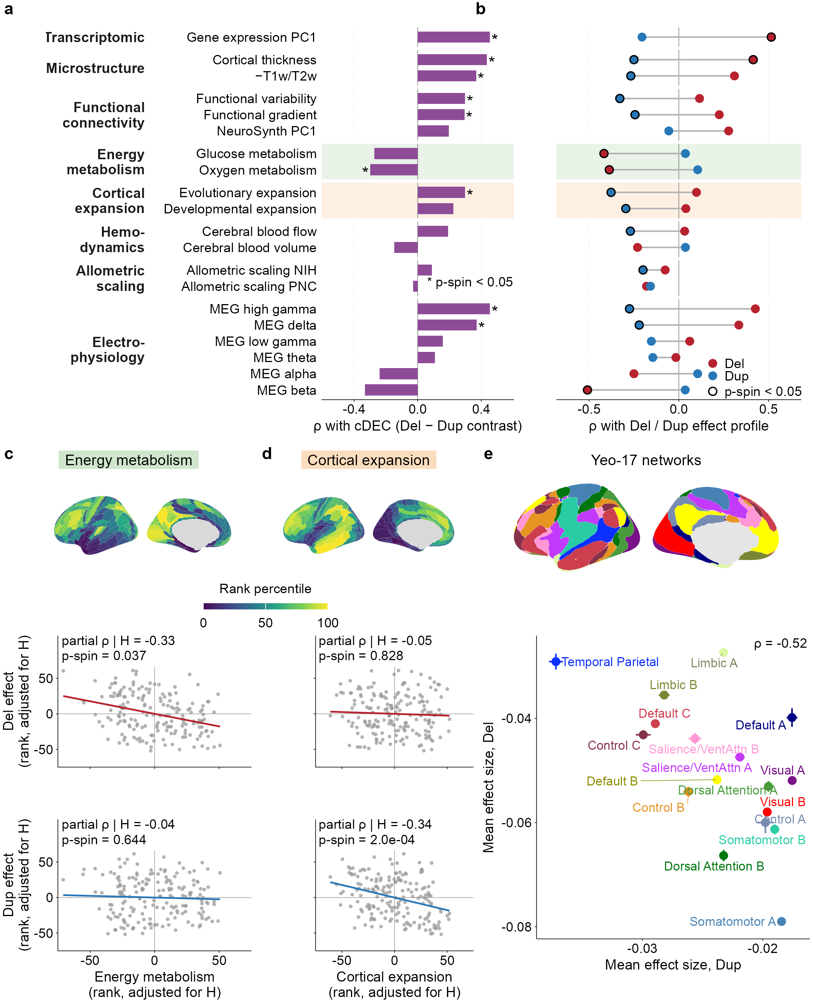

```{r setup, include=FALSE}
knitr::opts_chunk$set(echo = TRUE, warning = FALSE, message = FALSE, fig.path = "Fig3_files/figure-gfm/")
lines_R <- readLines(file.path(dirname(knitr::current_input(dir = TRUE)), "Fig3.R"))   # code chunks are read from Fig3.R
idx_chunk <- grep("^## ---- fig[0-9]_[A-Za-z0-9_]+ ----$", lines_R)
knitr::read_chunk(lines = lines_R, labels = sub("^## ---- (.*) ----$", "\\1", lines_R[idx_chunk]),
                  from = idx_chunk + 1L, to = c(idx_chunk[-1] - 1L, length(lines_R)))
knitr::opts_knit$set(root.dir = normalizePath(file.path(dirname(knitr::current_input(dir = TRUE)), "..", "..")))
```


## Fig. 3: Spatial decoding of deletion and duplication effects and their association with energy metabolism and cortical expansion
#### -- Figure legend -- ####

a) Spatial correlation between the cortical dosage-effect contrast (cDEC) and 20 normative cortical maps. The maps are grouped by domain: hierarchy and microstructure, energy metabolism, cortical expansion, hemodynamics, allometric scaling, and magnetoencephalography (MEG). Bars show Spearman's ρ. Asterisks mark two-sided spin-permutation p < 0.05. Positive ρ indicates that the map is high where duplication effects are relatively stronger than deletion effects. T1w/T2w is the inverse of the cortical hierarchy (H) used in Fig. 2. b) Spatial Spearman correlation of each map with the deletion (red) and duplication (blue) effect-size profiles. The grey line joining the two points shows their difference, the topographic contrast, T = ρ(Dup,map) - ρ(Del,map). Rows are in the same order as in a. Because effect sizes are negative, a negative ρ indicates larger effects where the map is high. A dark outline marks two-sided spin-permutation p < 0.05. Shaded rows mark the two dimensions analysed in c and d. c,d) Deletion (red) and duplication (blue) effects versus energy metabolism (c; oxygen and glucose metabolism) and cortical expansion (d; evolutionary and developmental expansion), adjusted for H. Partial Spearman ρ and two-sided p-spin (composite and H rotated jointly). Unadjusted results in Supplementary Fig. 13. e) Mean deletion versus duplication effect size across the 17 Yeo resting-state networks (± s.e.m.); colours match the inset network map. Spearman ρ and two-sided p-spin.

Spin-permutation tests used 10,000 null rotations and were two-sided. Source data are provided with this paper. Del, deletion; Dup, duplication; cDEC, cortical dosage-effect contrast; p-spin, spin-permutation p-value; ρ, Spearman correlation.
The code below is read from `Fig3.R` (same folder). Run it from the repository root, or knit this file. Statistics are read from the Supplementary Tables (`data/inputs/`); the plotted values are written to `data/source_data_sheets/` (Source Data).

#### Setup: paths, packages and style ####
```{r fig3_setup}
```

#### Data: effect sizes (Supplementary Table 4), 20 normative maps, spin rotations ####
```{r fig3_data}
```

#### Panels a and b ####
```{r fig3_panels_a_b}
```

#### Panels c and d ####
```{r fig3_panels_c_d}
```

#### Panel e ####
```{r fig3_panel_e}
```

#### Assemble and save ####
```{r fig3_assemble}
```

#### Fig. 3 ####

