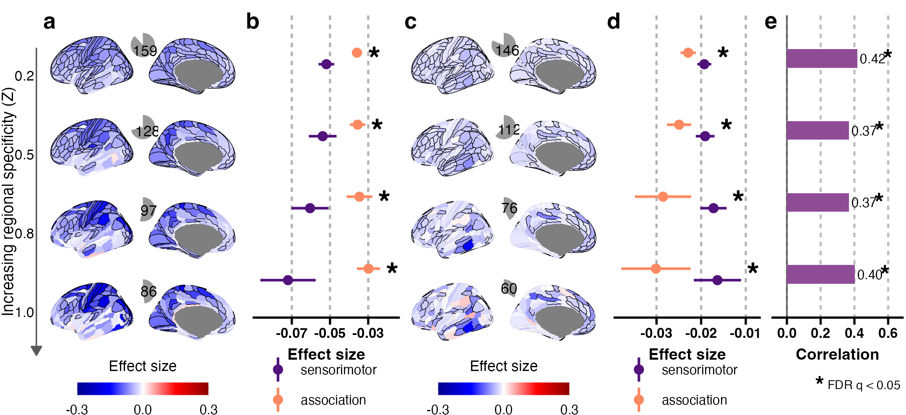

```{r setup, include=FALSE}
knitr::opts_chunk$set(echo = TRUE, warning = FALSE, message = FALSE, fig.path = "Fig4_files/figure-gfm/")
lines_R <- readLines(file.path(dirname(knitr::current_input(dir = TRUE)), "Fig4.R"))   # code chunks are read from Fig4.R
idx_chunk <- grep("^## ---- fig[0-9]_[A-Za-z0-9_]+ ----$", lines_R)
knitr::read_chunk(lines = lines_R, labels = sub("^## ---- (.*) ----$", "\\1", lines_R[idx_chunk]),
                  from = idx_chunk + 1L, to = c(idx_chunk[-1] - 1L, length(lines_R)))
knitr::opts_knit$set(root.dir = normalizePath(file.path(dirname(knitr::current_input(dir = TRUE)), "..", "..")))
```


## Fig. 4: Gene dosage effects on cognitive ability across levels of regional specificity
#### -- Figure legend -- ####

a,c) Cortical effect sizes maps for a) deletions and c) duplications across four levels of regional specificity (Z = 0.2, 0.5, 0.8 and 1.0). Increasing the threshold progressively restricts each regional gene set to genes with greater regional expression specificity. Regions significant after Bonferroni correction across 180 deletion and 180 duplication regional tests within each threshold are outlined in black. Pie charts indicate the number of significant cortical regions. b,d) Mean b) deletion and d) duplication effect sizes in sensorimotor and association cortical regions across regional-specificity thresholds. Sensorimotor and association regions comprise the bottom and top 30% of the T1w/T2w-derived cortical anatomical hierarchy (54 regions each). Points show means and horizontal ranges show 95% confidence intervals. Differences between the sensorimotor and association distributions were tested using two-sided Kolmogorov–Smirnov tests; asterisks indicate significance after FDR correction across the eight tests (q<0.05). e) Association between the cortical dosage-effect contrast (cDEC) and cortical hierarchy across regional-specificity thresholds. Bars show Spearman’s ρ between cDEC and cortical hierarchy, with correlation coefficients shown beside the bars. Asterisks indicate FDR-adjusted two-sided spin-permutation q<0.05.

Spin-permutation tests used 10,000 null rotations. Source data are provided with this paper. Del, deletion; Dup, duplication; cDEC, cortical dosage-effect contrast.
The code below is read from `Fig4.R` (same folder). Run it from the repository root, or knit this file. Statistics are read from the Supplementary Tables (`data/inputs/`); the plotted values are written to `data/source_data_sheets/` (Source Data).

#### Setup: paths and packages ####
```{r fig4_setup}
```

#### Functions ####
```{r fig4_functions}
```

#### Data: effect sizes (Supplementary Table 4), poles, statistics (Supplementary Tables 7 and 11) ####
```{r fig4_data}
```

#### Panels a and c (maps) ####
```{r fig4_panels_a_c}
```

#### Panels a and c (layout) ####
```{r fig4_layout_a_c}
```

#### Panels b and d ####
```{r fig4_panels_b_d}
```

#### Panel e ####
```{r fig4_panel_e}
```

#### Assemble and save ####
```{r fig4_assemble}
```

#### Fig. 4 ####

