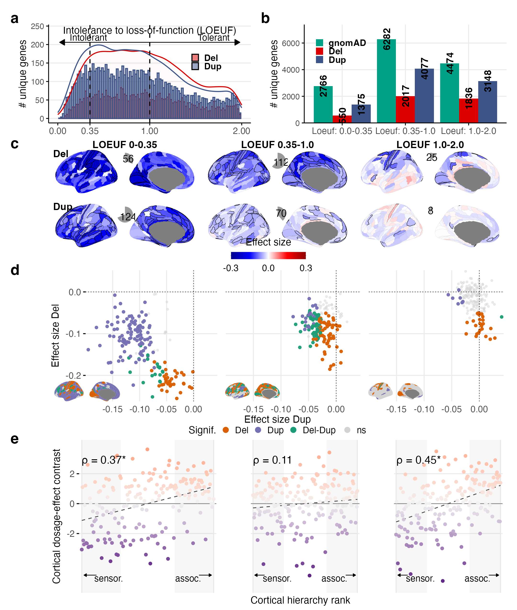

Fig5
================

## Fig. 5: Cortical deletion and duplication effects across levels of genetic constraint
#### -- Figure legend -- ####

a) Distribution of the number of genes deleted or duplicated at least once in our dataset, with respect to their genetic constraint (intolerance to loss of function; LOEUF values). Histograms show the numbers of unique genes observed in deletions and duplications across LOEUF bins, with density curves indicating their corresponding distributions. Dashed lines denote the boundaries used to define the three LOEUF strata (0-0.35, 0.35-1.0 and 1.0-2.0); lower LOEUF values indicate greater intolerance to loss of function. b) Genes stratified into three LOEUF categories: i) highly intolerant (Loeuf1: 0-0.35); ii) intolerant (Loeuf2: 0.35-1.0); and iii) tolerant (Loeuf3: 1.0-2.0). Green bars show the reference number of genes in each LOEUF category, and red and blue bars show the numbers observed in deletions and duplications, respectively. c) Cortical deletion and duplication effect-size maps across the three LOEUF strata. Regions significant after Bonferroni correction across 180 cortical regions, two CNV types and three LOEUF strata (1,080 tests) are outlined in black, and pie charts indicate the number of significant cortical regions. A common effect-size scale is used across strata. d) Relationship between deletion and duplication effect sizes across all 180 cortical regions within each LOEUF stratum. Regions significant for deletions, duplications or both are colored, whereas non-significant regions are shown in light grey. Insets show the cortical distribution of these significance classes using the same colors. Common x- and y-axis scales are used across strata to show changes in effect-size magnitude with genetic constraint. e) Association between the cortical dosage-effect contrast (cDEC) and cortical hierarchy within each LOEUF stratum. Each point represents one cortical region and is colored by cDEC; negative and positive values indicate relative deletion and duplication weighting, respectively. Shaded regions indicate the bottom and top 30% of the cortical hierarchy (54 regions each), corresponding to the sensorimotor and association poles, respectively. Dashed lines indicate linear fits. Spearman’s ρ is shown in each panel; asterisks indicate significant two-sided spin-permutation tests (p<0.05). Spin-permutation tests used 10,000 null rotations. Source data are provided with this paper. Del, deletion; Dup, duplication; cDEC, cortical dosage-effect contrast; LOEUF, loss-of-function observed/expected upper-bound fraction.
The code below is read from `Fig5.R` (same folder). Run it from the repository root, or knit this file. Statistics are read from the Supplementary Tables (`data/inputs/`); the plotted values are written to `data/source_data_sheets/` (Source Data).

#### Setup: paths and packages ####

``` r
#----- Project Directory and other paths ---------------------------------
flag_local = 2  # 1: Kuldeep's local system; Else: run from the repository root
if( flag_local == 1){
  project_dir <- "/Users/kuldeepkumar/Documents/Projects/Temp_CNV_GWAS_oct2022/Release_NG_R1_29oct2026/GitHub"
} else {
  project_dir <- getwd()
}

data_dir <- paste0(project_dir,"/data")
inputs_dir <- paste0(data_dir,"/inputs")
source_data_dir <- paste0(data_dir,"/source_data_sheets")
OUT_DIR <- paste0(project_dir,"/Figs/Fig5")

#-----------------------------------------------------------------------------
# Packages
#-----------------------------------------------------------------------------

suppressPackageStartupMessages({
  library(ggplot2)
  library(ggprism)
  library(ggrepel)
  library(dplyr)
  library(tibble)
  library(readxl)
  library(ggseg)
  library(ggsegGlasser)
  library(cowplot)
  library(patchwork)
})
source(file.path(project_dir, "functions/fn_write_SourceData_sheet.R"))

#-----------------------------------------------------------------------------
# PART A: Parameters and variables
#-----------------------------------------------------------------------------

FIG_WIDTH_IN <- 7.20
FIG_HEIGHT_IN <- 8.50
PNG_DPI <- 600

filename_ST_C <- file.path(inputs_dir, "SupplementaryTables_NatGenRevision_29oct2026.xlsx")
filename_maps_C <- file.path(inputs_dir, "inputs_main_neuromaps20_Glasser180.csv")
filename_genes_C <- file.path(inputs_dir, "inputs_Fig5_unique_genes_LOEUF.csv")
filename_counts_C <- file.path(inputs_dir, "inputs_Fig5_gene_counts_LOEUF_strata.csv")

# Global font-size parameters (points at final figure size).
buffer_PT <- 3
FONT_MIN_PT <- 5 + buffer_PT
FONT_BASE_PT <- 7 + buffer_PT
FONT_AXIS_TITLE_PT <- 7 + buffer_PT
FONT_AXIS_TEXT_PT <- 6 + buffer_PT
FONT_LEGEND_TITLE_PT <- 7 + buffer_PT
FONT_LEGEND_TEXT_PT <- 6 + buffer_PT
FONT_ANNOTATION_PT <- 6 + buffer_PT
FONT_ROI_LABEL_PT <- 5.5
FONT_INTERNAL_LABEL_PT <- 7 + buffer_PT
FONT_PANEL_TAG_PT <- 12 + buffer_PT  ## Panel Tag label
FONT_BRAIN_PT <- 7 + buffer_PT

PT_PER_MM <- 72.27 / 25.4
pt_to_geom <- function(x) x / PT_PER_MM
dir.create(OUT_DIR, recursive = TRUE, showWarnings = FALSE)

COL_DEL <- "#D95F02"
COL_DUP <- "#7570B3"
COL_BOTH <- "#1B9E77"
COL_NS <- "#D3D3D3"
COL_SENSORIMOTOR <- "#51127c"
COL_ASSOCIATION <- "#fc8961"
COL_NEUTRAL <- "#F2F2F2"

# Shared plotting limits for panels d / e
PANEL_D_YLIM <- c(-5.5, 4.5)
PANEL_E_XLIM <- c(-0.20, 0.044)
PANEL_E_YLIM <- c(-0.262, 0.052)

LOEUF_BONFERRONI_DENOMINATOR <- 180L * 2L * 3L  # 1,080 tests
```

#### Functions ####

``` r
assert_file <- function(x) if (!file.exists(x)) stop("Missing required input file: ", x, call. = FALSE)
zscore <- function(x) as.numeric(scale(as.numeric(x)))

save_figure <- function(plot_obj, stem, width, height) {
  svg_file <- file.path(OUT_DIR, paste0(stem, ".svg")); png_file <- file.path(OUT_DIR, paste0(stem, ".png"))
  svglite::svglite(svg_file, width = width, height = height, bg = "white")
  print(plot_obj); invisible(grDevices::dev.off())
  ggsave(png_file, plot_obj, width = width, height = height, units = "in", dpi = PNG_DPI, bg = "white")
}

# LOEUF family: 180 regions x 2 CNV types x 3 strata = 1,080 tests (Bonferroni over the pooled family)
bonferroni_del_dup <- function(p_del, p_dup, k_strata = 3L) {
  denominator <- length(p_del) * 2L * k_strata
  list(del = pmin(as.numeric(p_del) * denominator, 1), dup = pmin(as.numeric(p_dup) * denominator, 1))
}

make_pie <- function(n_sig, n_total = 180) {
  d <- data.frame(x=factor(c("ns","sig"), levels=c("ns","sig")), n=c(n_total-n_sig,n_sig), label=c("",n_sig))
  ggplot(d,aes(x="",y=n,fill=x))+geom_col(width=1)+coord_polar("y")+
    geom_text(aes(label=label),position=position_stack(vjust=.5),size=pt_to_geom(FONT_INTERNAL_LABEL_PT))+
    scale_fill_manual(values=c("white","#999999"))+theme_void()+theme(legend.position="none")
}

make_effect_map <- function(effect, p_adj, cbar_lim = .30, show_legend = FALSE) {
  roi <- names(glasser$palette)[1:180]
  dat <- tibble(region=roi, effect=pmax(pmin(effect,cbar_lim),-cbar_lim),
                edge_col=ifelse(p_adj<.05,"black","grey70"), edge_size=ifelse(p_adj<.05,0.15,0.03))
  p = ggseg(dat, atlas="glasser", position="dispersed", hemisphere="left",
        mapping=aes(fill=effect,colour=I(edge_col),size=I(edge_size)),adapt_scales=TRUE)+
    theme_brain(text.family="sans",text.size=FONT_BRAIN_PT)+
    scale_fill_gradientn(limits = c(-cbar_lim, cbar_lim), breaks = c(-cbar_lim, 0, cbar_lim),
                         colours = colorRampPalette(c("blue4", "blue", "white", "red", "red4"))(300),
                         oob = scales::squish) +
    guides(fill = guide_colourbar(title = "Effect size", title.position = "top", barwidth = 5.25, barheight = .5, title.hjust = .5)) +
    theme(legend.position = if(show_legend) "bottom" else "none", legend.title = element_text(size = FONT_LEGEND_TITLE_PT),
          legend.text = element_text(size = FONT_LEGEND_TEXT_PT), plot.margin = margin(-8, 0, -8, 0))
  p <- p + theme(axis.title = element_blank(), axis.text.x = element_blank()) +
    theme(plot.margin = grid::unit(c(-28, 0, -28, 0), "mm"))
  p
}

# Small cortical significance map (inset in the Del-vs-Dup scatterplots)
make_significance_map <- function(sig_class) {
  roi <- names(glasser$palette)[1:180]
  sig_class <- factor(sig_class, levels = c("ns", "Del", "Dup", "Del-Dup"))
  dat <- tibble(region = roi, significance = sig_class)
  ggseg(dat, atlas = "glasser", position = "dispersed", hemisphere = "left",
        mapping = aes(fill = significance), colour = "grey75", size = 0.01, adapt_scales = TRUE) +
    theme_brain(text.family = "sans", text.size = FONT_BRAIN_PT) +
    scale_fill_manual(values = c("ns" = COL_NS, "Del" = COL_DEL, "Dup" = COL_DUP, "Del-Dup" = COL_BOTH), drop = FALSE) +
    theme(legend.position = "none", axis.title = element_blank(), axis.text.x = element_blank(),
          plot.margin = grid::unit(c(-20, 0, -20, 0), "mm"))
}

#-----------------------------------------------------------------------------
# PART B: Load data
#-----------------------------------------------------------------------------
```

#### Data: effect sizes (Supplementary Table 4), H, profile statistics (Supplementary Table 7) ####

``` r
assert_file(filename_ST_C); assert_file(filename_maps_C); assert_file(filename_genes_C); assert_file(filename_counts_C)
df_ST4 <- read_excel(filename_ST_C, sheet = "ST4")
loeuf_sets <- c("genetic_constraint_loeuf_0p0_0p35", "genetic_constraint_loeuf_0p35_1p0", "genetic_constraint_loeuf_1p0_2p0")
loeuf_labels <- c("LOEUF 0-0.35", "LOEUF 0.35-1.0", "LOEUF 1.0-2.0")
d5 <- df_ST4 %>% filter(gene_set_exp_category == "genetic_constraint", gene_set_exp %in% loeuf_sets)

roi_names <- names(glasser$palette)[1:180]
roi_ST_names <- paste0("L_", gsub("-", ".", roi_names, fixed = TRUE))
neuromaps <- read.csv(filename_maps_C, check.names=FALSE)
neuromaps <- neuromaps[match(roi_names, neuromaps$glasser_region), ]
hierarchy_z <- -zscore(neuromaps$T1T2ratio)
hierarchy_rank <- rank(hierarchy_z, ties.method="average")

stats_all <- read_excel(filename_ST_C, sheet = "ST7") %>%   # Supplementary Table 7: profile statistics
  filter(gene_set_exp_category == "genetic_constraint", gene_set_exp %in% loeuf_sets) %>%
  arrange(match(gene_set_exp, loeuf_sets))
if (nrow(stats_all)!=3) stop("Expected three LOEUF-category rows in ST7.")

#-----------------------------------------------------------------------------
# PART C: Panels
#-----------------------------------------------------------------------------
```

#### Panel a ####

``` r
#----- Panel a: LOEUF of unique deleted / duplicated genes (Fig. 5a)
source_a <- read.csv(filename_genes_C)    # one row per unique gene and CNV type (ENSEMBL ID, symbol, LOEUF)

panel_A <- ggplot(source_a, aes(x=oe_lof_upper, color=TYPE, fill=TYPE))+
  geom_histogram(bins=100,alpha=.5,position="identity")+
  geom_density(aes(y=after_stat(density)*(nrow(source_a)*.02)),alpha=.01)+
  theme_minimal(base_size=FONT_BASE_PT)+
  scale_color_manual(guide="none",values=c("#DC0000FF","#3C5488FF"))+
  scale_fill_manual(values=c("#DC0000FF","#3C5488FF"),labels=c("Del","Dup"),name=NULL,
                    guide=guide_legend(keyheight=grid::unit(0.28, "cm"), keywidth=grid::unit(0.28, "cm")))+
  geom_vline(xintercept=.35,linetype="dashed")+geom_vline(xintercept=1,linetype="dashed")+
  annotate("segment", x=.02, xend=1.98, y=206, yend=206,
           arrow=grid::arrow(ends="both", type="closed", length=grid::unit(0.08,"in")), linewidth=.35) +
  annotate("text", x=.13, y=219, label="Intolerant", hjust=0, size=pt_to_geom(FONT_MIN_PT+1)) +
  annotate("text", x=1.87, y=219, label="Tolerant", hjust=1, size=pt_to_geom(FONT_MIN_PT+1)) +
  annotate("text", x=1.0, y=239, label="Intolerance to loss-of-function (LOEUF)", hjust=.5, size=pt_to_geom(FONT_AXIS_TITLE_PT)) +
  scale_x_continuous(limits=c(0,2),breaks=c(0,.35,1,2))+
  coord_cartesian(ylim=c(0, 242), clip="off")+
  labs(x=NULL,y="# unique genes")+
  theme(
        panel.grid.minor=element_blank(),
        panel.grid.major.x=element_blank(),
        axis.line=element_line(colour="black", linewidth=.4),
        axis.ticks=element_line(colour="black", linewidth=.4),
        legend.position=c(.78,.62),
        legend.text=element_text(face="bold",size=FONT_LEGEND_TEXT_PT),
        legend.key.height=grid::unit(0.28, "cm"),
        legend.key.width=grid::unit(0.28, "cm"),
        legend.spacing.y=grid::unit(0.02, "cm"),
        legend.box.spacing=grid::unit(0, "cm"),
        axis.text.x=element_text(size=FONT_AXIS_TEXT_PT),
        axis.title=element_text(size=FONT_AXIS_TITLE_PT))
```

#### Panel b ####

``` r
#----- Panel b: unique genes per LOEUF stratum (Fig. 5b)
source_b <- read.csv(filename_counts_C)
source_b$array_TYPE <- factor(source_b$array_TYPE,levels=c("gnomAD","DEL","DUP"))
source_b$array_GeneSet <- factor(source_b$array_GeneSet,levels=c("Loeuf: 0.0-0.35","Loeuf: 0.35-1.0","Loeuf: 1.0-2.0"))
ymax_b <- max(source_b$array_count_summary, na.rm = TRUE)

panel_B <- ggplot(source_b,aes(x=array_GeneSet,y=array_count_summary,fill=array_TYPE))+
  geom_col(position="dodge")+
  geom_text(aes(label=array_count_summary),position=position_dodge(width=.9),angle=90,vjust=.5,hjust=.5,
            size=pt_to_geom(FONT_INTERNAL_LABEL_PT),fontface="bold")+
  theme_minimal(base_size=FONT_BASE_PT)+xlab(NULL)+ylab("# unique genes")+
  scale_fill_manual(values=c("#00A087FF","#DC0000FF","#3C5488FF"),labels=c("gnomAD","Del","Dup"),name=NULL,
                    guide=guide_legend(keyheight=grid::unit(0.30, "cm"), keywidth=grid::unit(0.30, "cm"))) +
  scale_y_continuous(expand=expansion(mult=c(0, .05)), limits=c(0, ymax_b*1.12)) +
  theme(panel.grid.minor=element_blank(),
        axis.line=element_line(colour="black", linewidth=.4),
        axis.ticks=element_line(colour="black", linewidth=.4),
        legend.position=c(.03,.55),legend.justification=c(0,0),
        legend.text=element_text(face="bold",size=FONT_LEGEND_TEXT_PT),
        legend.key.height=grid::unit(0.30, "cm"),
        legend.key.width=grid::unit(0.30, "cm"),
        legend.spacing.y=grid::unit(0.02, "cm"),
        legend.box.spacing=grid::unit(0, "cm"),
        axis.text.x=element_text(size=FONT_AXIS_TEXT_PT),axis.title=element_text(size=FONT_AXIS_TITLE_PT))

# Source Data a-b: aggregated counts only (panel a: histogram bins as plotted, 100 bins on [0, 2]; panel b: counts per stratum)
df_hist_a <- ggplot_build(panel_A)$data[[1]]
df_source_ab <- bind_rows(
  data.frame(panel = "a", cnv_type = c("DEL", "DUP")[df_hist_a$group], LOEUF_bin_lower = df_hist_a$xmin, LOEUF_bin_upper = df_hist_a$xmax,
             n_unique_genes = df_hist_a$count),
  data.frame(panel = "b", cnv_type = as.character(source_b$array_TYPE), LOEUF_stratum = as.character(source_b$array_GeneSet),
             n_unique_genes = source_b$array_count_summary)
)
stopifnot(sum(df_hist_a$count) == sum(!is.na(source_a$oe_lof_upper) & source_a$oe_lof_upper >= 0 & source_a$oe_lof_upper <= 2))
fn_write_SourceData_sheet(df_source_ab, "Fig5a-b", source_data_dir)
```

#### Panels c, d and e (data and plots) ####

``` r
#----- Panels c-e: maps, Del vs Dup, cDEC vs hierarchy per LOEUF stratum (Fig. 5c-e)
map_list <- scatter_h_list <- scatter_dd_list <- vector("list",3)
source_cde <- list()
source_stats <- list()

for(i in 1:3){
  gs <- loeuf_sets[i]
  lab <- loeuf_labels[i]
  xdel <- d5 %>% filter(gene_set_exp==gs,cnv_type=="DEL"); xdel <- xdel[match(roi_ST_names, xdel$gene_set_name), ]
  xdup <- d5 %>% filter(gene_set_exp==gs,cnv_type=="DUP"); xdup <- xdup[match(roi_ST_names, xdup$gene_set_name), ]
  if(anyNA(xdel$gene_set_name) || anyNA(xdup$gene_set_name)) stop("Expected 180 DEL and DUP regions for ",gs)
  es_del <- as.numeric(xdel$Estimate); es_dup <- as.numeric(xdup$Estimate)
  p_del <- as.numeric(xdel$pvalue); p_dup <- as.numeric(xdup$pvalue)
  pa <- bonferroni_del_dup(p_del, p_dup, k_strata = 3L)

  sig <- rep("ns",180)
  sig[pa$del<.05 & pa$dup>=.05] <- "Del"
  sig[pa$del>=.05 & pa$dup<.05] <- "Dup"
  sig[pa$del<.05 & pa$dup<.05] <- "Del-Dup"
  sig <- factor(sig,levels=c("ns","Del","Dup","Del-Dup"))

  del_z <- zscore(es_del); dup_z <- zscore(es_dup); delta_z <- del_z-dup_z
  delta_lim <- ceiling(max(abs(delta_z),na.rm=TRUE)*2)/2; if(delta_lim<1) delta_lim<-1

  # Panel c maps + pies
  md0 <- make_effect_map(es_del,pa$del,.30,show_legend=(i==3))
  if(i==3) effect_legend <- cowplot::get_legend(md0)
  md <- md0+theme(legend.position="none")
  mu <- make_effect_map(es_dup,pa$dup,.30,FALSE)
  md <- ggdraw(md)+draw_plot(make_pie(sum(pa$del<.05)),x=.37,y=.54,width=.26,height=.34)
  mu <- ggdraw(mu)+draw_plot(make_pie(sum(pa$dup<.05)),x=.37,y=.54,width=.26,height=.34)
  map_list[[i]] <- ggdraw() +
    draw_plot(md, x=0, y=.485, width=1, height=.535) +
    draw_plot(mu, x=0, y=-.005, width=1, height=.535)

  # Statistics from ST7: full-profile Del-Dup correlation and rho(cDEC, H) with two-sided p-spin
  ss <- stats_all[stats_all$gene_set_exp==gs,,drop=FALSE]
  if (nrow(ss) != 1) stop("ST7 row missing for ", gs)
  rho_full <- ss$rho_DEL_DUP_all[1]; pspin_full <- ss$pspin_DEL_DUP_all[1]
  rho_h <- ss$rho_cDEC_H[1]; pspin_h <- ss$pspin_cDEC_H[1]   # cDEC = z(Del) - z(Dup)
  if (abs(cor(es_del, es_dup, method = "spearman") - rho_full) > 1e-9 || abs(cor(delta_z, hierarchy_z, method = "spearman") - rho_h) > 1e-9) stop("Recomputed rho does not match ST7 for ", gs)
  idx_sig <- sig!="ns"
  rho_sig <- suppressWarnings(cor(es_del[idx_sig],es_dup[idx_sig],method="spearman"))   # descriptive only

  # Panel e: cDEC vs hierarchy rank
  ddh <- data.frame(ROI=roi_names,hierarchy_rank=hierarchy_rank,hierarchy=hierarchy_z,delta_z=delta_z)
  stat_h <- paste0("ρ = ",sprintf("%.2f",rho_h),ifelse(pspin_h<.05,"*",""))
  scatter_h_list[[i]] <- ggplot(ddh,aes(x=hierarchy_rank,y=delta_z,color=delta_z))+
    annotate("rect", xmin=1, xmax=54, ymin=-Inf, ymax=Inf, fill="grey70", alpha=.10) +
    annotate("rect", xmin=127, xmax=180, ymin=-Inf, ymax=Inf, fill="grey70", alpha=.10) +
    geom_hline(yintercept=0,color="grey55",linewidth=.35)+
    geom_smooth(aes(group=1),method="lm",se=FALSE,linetype="dashed",linewidth=.4,color="grey30")+
    geom_point(size=1.1,alpha=.95)+
    scale_color_gradient2(low=COL_SENSORIMOTOR,mid=COL_NEUTRAL,high=COL_ASSOCIATION,midpoint=0,
                          limits=c(-delta_lim,delta_lim),oob=scales::squish,guide="none")+
    annotate("text",x=-Inf,y=Inf,label=stat_h,hjust=-.05,vjust=3,size=pt_to_geom(FONT_ANNOTATION_PT + 2))+
    scale_x_continuous(breaks=c(1,180), labels=NULL, expand=expansion(mult=c(0.02,0.02)))+
    scale_y_continuous(limits=c(-5.5,3.8), breaks=c(-2,0,2))+
    labs(x=NULL,y=if(i==1) "Cortical dosage-effect contrast" else NULL)+
    coord_cartesian(clip="off")+
    theme_minimal(base_size=FONT_BASE_PT)+
    theme(
      panel.grid.minor=element_blank(),
      axis.text.x=element_blank(),
      axis.text.y=if(i==1) element_text(size=FONT_AXIS_TEXT_PT) else element_blank(),
      axis.ticks.y=if(i==1) element_line() else element_blank(),
      axis.title.y=if(i==1) element_text(size=FONT_AXIS_TITLE_PT) else element_blank(),
      plot.margin=margin(4,4,4,4)
    ) +
    annotate("text", x=18, y=-5.0, label="sensor.", hjust=0, size=pt_to_geom(FONT_AXIS_TEXT_PT)) +
    annotate("text", x=163, y=-5.0, label="assoc.", hjust=1, size=pt_to_geom(FONT_AXIS_TEXT_PT)) +
    annotate("segment", x=21, xend=4, y=-4.78, yend=-4.78, arrow=arrow(length=unit(0.10, "cm"), type="closed"), linewidth=.32) +
    annotate("segment", x=160, xend=177, y=-4.78, yend=-4.78, arrow=arrow(length=unit(0.10, "cm"), type="closed"), linewidth=.32)

  # Panel d data: all 180 regions
  dds <- data.frame(LOEUF_category=lab, gene_set_exp=gs, ROI=roi_names, DEL=es_del, DUP=es_dup, significance=sig)
  scatter_dd_list[[i]] <- dds

  source_cde[[i]] <- data.frame(
    gene_set_exp=gs, LOEUF_category=lab, gene_set_name=roi_ST_names, glasser_region=roi_names,
    Estimate_DEL=es_del, pvalue_DEL=p_del, pvalue_bonferroni_1080_DEL=pa$del,
    Estimate_DUP=es_dup, pvalue_DUP=p_dup, pvalue_bonferroni_1080_DUP=pa$dup,
    significance_class=as.character(sig), z_DEL=del_z, z_DUP=dup_z, cDEC=delta_z,
    T1T2ratio=neuromaps$T1T2ratio, H=hierarchy_z, H_rank=hierarchy_rank
  )
  source_stats[[i]] <- data.frame(
    gene_set_exp=gs, LOEUF_category=lab, n_sig_regions_DEL_bonferroni_1080=sum(pa$del<.05), n_sig_regions_DUP_bonferroni_1080=sum(pa$dup<.05),
    rho_DEL_DUP_all=rho_full, pspin_DEL_DUP_all=pspin_full,
    rho_DEL_DUP_sig_descriptive=rho_sig, n_sig_union=sum(idx_sig),
    rho_cDEC_H=rho_h, pspin_cDEC_H=pspin_h, printed_e=stat_h
  )
}
source_cde_df <- bind_rows(source_cde); source_stats_df <- bind_rows(source_stats)
fn_write_SourceData_sheet(source_cde_df, "Fig5c-e", source_data_dir)
fn_write_SourceData_sheet(source_stats_df, "Fig5e_stats", source_data_dir)
```

#### Panel c (layout) ####

``` r
map_cols <- lapply(seq_along(map_list), function(i) {
  plot_grid(ggdraw() + draw_label(loeuf_labels[i], x=.5, y=.28, fontface="bold", size=FONT_INTERNAL_LABEL_PT),
            map_list[[i]], ncol=1, rel_heights=c(.045, .955))
})
panel_C_main <- plot_grid(plotlist=map_cols, ncol=3, align="hv")
panel_C_main <- ggdraw(panel_C_main) +
  draw_label("Del", x=.01, y=.92, hjust=0, vjust=1, fontface="bold", size=FONT_INTERNAL_LABEL_PT) +
  draw_label("Dup", x=.01, y=.46, hjust=0, vjust=1, fontface="bold", size=FONT_INTERNAL_LABEL_PT)
effect_legend_compact <- ggdraw() + draw_plot(effect_legend, x=.28, y=.805, width=.4, height=.5)
panel_C <- plot_grid(panel_C_main, effect_legend_compact, ncol=1, rel_heights=c(1, .1))
```

#### Panel d (layout) ####

``` r
scatter_all_df <- bind_rows(scatter_dd_list)
scatter_dd_panels <- lapply(seq_along(loeuf_sets), function(i) {
  gs <- loeuf_sets[i]
  dplot <- scatter_all_df %>% filter(gene_set_exp == gs)
  p_scatter <- ggplot(dplot, aes(x = DUP, y = DEL)) +
    geom_point(data = subset(dplot, significance == "ns"), color = COL_NS, size = 0.65, alpha = 0.40) +
    geom_point(data = subset(dplot, significance != "ns"), aes(color = significance), size = 1.0, alpha = 0.95) +
    scale_color_manual(values = c("Del" = COL_DEL, "Dup" = COL_DUP, "Del-Dup" = COL_BOTH, "ns" = COL_NS),
                       limits = c("Del", "Dup", "Del-Dup", "ns"), drop = FALSE, name = "Signif.") +
    geom_hline(yintercept = 0, linetype = "dotted", linewidth = .30) +
    geom_vline(xintercept = 0, linetype = "dotted", linewidth = .30) +
    scale_x_continuous(limits = PANEL_E_XLIM, breaks = c(-0.15, -0.10, -0.05, 0.00), expand = expansion(mult = c(0, 0))) +
    scale_y_continuous(limits = PANEL_E_YLIM, breaks = c(-0.20, -0.10, 0.00), expand = expansion(mult = c(0, 0))) +
    labs(x = NULL, y = if(i == 1) "Effect size Del" else NULL) +
    theme_minimal(base_size = FONT_BASE_PT) +
    theme(
      panel.grid.minor = element_blank(),
      legend.position = "none",
      axis.text.x = element_text(size = FONT_AXIS_TEXT_PT),
      axis.text.y = if(i == 1) element_text(size = FONT_AXIS_TEXT_PT) else element_blank(),
      axis.ticks.y = if(i == 1) element_line() else element_blank(),
      axis.title.y = if(i == 1) element_text(size = FONT_AXIS_TITLE_PT) else element_blank(),
      axis.title.x = element_text(size = FONT_AXIS_TITLE_PT),
      plot.margin = margin(3, 3, 3, 3)
    )
  p_sig_map <- make_significance_map(as.character(dplot$significance))
  ggdraw(p_scatter) + draw_plot(p_sig_map, x = 0.015, y = 0.015, width = 0.42, height = 0.30)
})

legend_e_base <- ggplot(
  data.frame(x = 1, y = 1, grp = factor(c("Del", "Dup", "Del-Dup", "ns"), levels = c("Del", "Dup", "Del-Dup", "ns"))),
  aes(x = x, y = y, color = grp)) +
  geom_point(size = 2.2) +
  scale_color_manual(values = c("Del" = COL_DEL, "Dup" = COL_DUP, "Del-Dup" = COL_BOTH, "ns" = COL_NS), name = "Signif.", drop = FALSE) +
  theme_void() +
  theme(legend.position = "bottom", legend.direction = "horizontal",
        legend.title = element_text(size = FONT_LEGEND_TITLE_PT), legend.text = element_text(size = FONT_LEGEND_TEXT_PT),
        legend.key.width = grid::unit(0.28, "cm"), legend.spacing.x = grid::unit(0.08, "cm"), legend.margin = margin(0, 0, 0, 0))
legend_e <- cowplot::get_legend(legend_e_base +
  guides(color = guide_legend(nrow = 1, byrow = TRUE, title.position = "left", title.hjust = 1)))

panel_D_row <- plot_grid(plotlist = scatter_dd_panels, ncol = 3, align = "hv", rel_widths = c(1.20, 1, 1))
panel_D_xlab <- ggdraw() + draw_label("Effect size Dup", x = .5, y = .72, size = FONT_AXIS_TITLE_PT)
panel_D_legend_row <- ggdraw(legend_e)
panel_D <- plot_grid(panel_D_row, panel_D_xlab, panel_D_legend_row, ncol = 1, rel_heights = c(1, .045, .080))
```

#### Panel e (layout) ####

``` r
panel_E_row <- plot_grid(plotlist = scatter_h_list, ncol = 3, align = "hv", rel_widths = c(1.20, 1, 1))
panel_E_xlab <- ggdraw() + draw_label("Cortical hierarchy rank", x = .55, y = .88, size = FONT_AXIS_TITLE_PT)
panel_E <- plot_grid(panel_E_row, panel_E_xlab, ncol = 1, rel_heights = c(1, .032))

#-----------------------------------------------------------------------------
# PART D: Assemble and save
#-----------------------------------------------------------------------------
```

#### Assemble and save ####

``` r
top <- panel_A | panel_B
final_fig <- top / panel_C / panel_D / panel_E +
  plot_layout(heights = c(.7, .9, 1.2, 1.2)) +
  plot_annotation(tag_levels="a",theme=theme(plot.tag=element_text(face="bold",size=FONT_PANEL_TAG_PT))) &
  theme(plot.tag=element_text(face="bold",size=FONT_PANEL_TAG_PT))

save_figure(final_fig,"Fig5",FIG_WIDTH_IN,FIG_HEIGHT_IN)
message("Saved Fig. 5 to: ", OUT_DIR)
```

#### Fig. 5 ####

